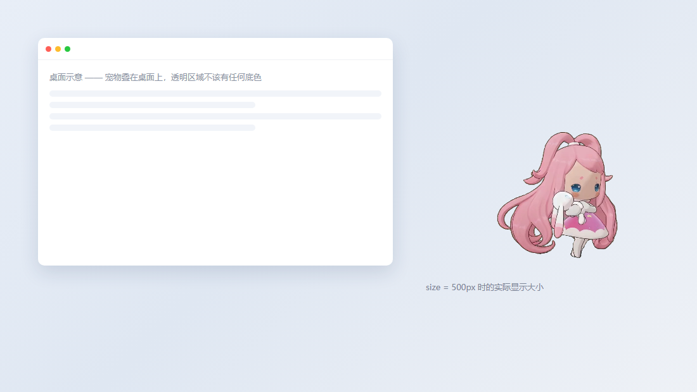

# dsh-pet 宠物包生成器

把「绿幕 + 角色」的 MP4 批量转成 [dsh-pet](https://github.com/PC2005-cloud/dsh-pet) 能吃的素材（VP9 + Alpha 的 WebM），
自动生成宠物配置，并告诉你这些文件该放到插件的哪个位置。

给豆包/即梦这类工具生成的虚拟角色视频用：一段 4~10 秒的绿幕素材 → 一个能站在桌面上的宠物动作。



> 仓库里的 `example/` 是一套完整可用的实例：13 段原始 MP4、13 段转好的 WebM、一份配好的 `xiaofen-config.json`
> （角色「小粉」，源自洛克王国异色雪影娃娃，粉发双马尾 + 白兔抱枕）。可直接照抄，也可只拿转码脚本处理自己的素材。
>
> 整个仓库约 50 MB（素材 12 MB + 成品 38 MB），直接 `git push` 就行，不用 Git LFS。
> 只想留一样的话，`example/source/` 是输入、`example/webm/` 是可直接使用的成品。

---

## 目录

```
.
├── skills/dsh-pet-pack-builder/   ← 可复用技能（7 步流程 + 5 个脚本）
│   ├── SKILL.md                   全流程说明：扫素材 → 目检 → 转码 → 体检 → 生成配置 → 安装
│   ├── scripts/
│   │   ├── envcheck.py            装 numpy、本机没 ffmpeg 时自动下静态构建
│   │   ├── analyze.py             探规格 / 标定绿幕色相 / 算包围盒 / 查水印 → source-profile.json
│   │   ├── keyer.py               HSV 抠像核心（去溢色、清阴影、水印遮罩）
│   │   ├── encode.py              抠像 → 颜色外渗 → VP9 Alpha 编码
│   │   ├── check.py               preview（棋盘格/品红底目检）、verify（alpha/绿溢/清晰度）
│   │   ├── make_config.py         按文件名关键词分池，生成并校验配置
│   │   └── glass_prop.py          镜子/玻璃板的镜面重建（半透明道具专用）
│   ├── references/
│   │   ├── pipeline.md            每一步为什么这么写，以及踩过的坑
│   │   └── petpack-schema.md      pet pack 配置字段完整说明
│   └── assets/wm_mask_1280x720.npz  右下角「豆包AI生成」水印的逐像素遮罩
│
├── example/
│   ├── source/    13 段原始绿幕 MP4（1280×720 / 24fps）
│   ├── webm/      13 段转好的成品（VP9 + Alpha，可直接装进插件）
│   ├── xiaofen-config.json   配套宠物配置（JSONC，带注释）
│   └── *.png      preview / before-after 两张效果图
│
└── docs/install-into-dsh-pet.md   ← 怎么把这些文件放进插件（重点看这个）
```

---

## 三步跑起来

### 0. 环境

Python 3.9+ 即可，其余自动搞定：

```sh
python skills/dsh-pet-pack-builder/scripts/envcheck.py
# numpy 缺失会自动 pip 安装；本机没有 ffmpeg 会从 npm 镜像下静态构建到
# ~/.workbuddy/tools/petpack/ffmpeg/（约 80MB，只需一次）
```

已有 ffmpeg 的话设 `FFMPEG=<路径>` 复用它，不会重复下载。

### 1. 装成技能（可选，但推荐）

```sh
# Claude Code / WorkBuddy 等支持 skill 的环境
cp -r skills/dsh-pet-pack-builder ~/.workbuddy/skills/
```

之后直接说「把 xxx 文件夹里的新动作转成宠物素材」就会自动按 SKILL.md 的流程走。
不装也能用，下面全是命令行。

### 2. 转码

```sh
python skills/dsh-pet-pack-builder/scripts/analyze.py \
    --src example/source --out source-profile.json

python skills/dsh-pet-pack-builder/scripts/encode.py \
    --src example/source --out build/xiaofen-animation \
    --profile source-profile.json
```

输出是 13 个 `<动画名>.webm`，1280×720、源帧率、VP9 `yuva420p`（带真透明通道）。

### 3. 装进 dsh-pet

```sh
python skills/dsh-pet-pack-builder/scripts/make_config.py \
    --anim-dir build/xiaofen-animation \
    --name 小粉 --id xiaofen \
    --persona "你是主人桌面上的Q版粉发小姑娘，怀里总抱着一只白色小兔子……" \
    --install
```

`--install` 会把配置和素材一起复制到 `$DSH_HOME/dsh-pet/pet/`（默认 `~/.dsh/dsh-pet/pet/`），
和内置宠物并存。细节、路径规则、缓存坑见 **[docs/install-into-dsh-pet.md](docs/install-into-dsh-pet.md)**。

---

## 装进插件时的硬规则

这几条踩过才知道，照做能省掉大部分「装了但不动」：

| 规则 | 说明 |
|---|---|
| 目录必须叫 `<前缀>-animation` | 插件按配置文件名前缀去找素材目录，名字不一致直接 404，**不会**回落到内置素材 |
| 素材目录是扁平的 | `pet/xiaofen-animation/待机.webm`，**没有** `webm/` 子目录（主宠物才是 `main-animation/webm/`） |
| 文件名 = 动画名 | 配置里写了 `"idle": ["待机"]`，就必须有 `待机.webm`，一个字都不能差 |
| 必须 16:9 | 插件按 `size × 9/16` 定高，比例不对会被拉伸；脚本会自动补透明边 |
| 必须 `yuva420p` | 否则 WebM 里没有 alpha，宠物会带黑底方块 |
| 换素材必须清缓存 | 插件给素材写死 `cache-control: max-age=3600` 且无 ETag。桌面端删 `%APPDATA%/dsh-pet-electron-helper/{Cache,Code Cache,GPUCache}` 后重启；网页端 Ctrl+Shift+R |

---

## 参数速查

| 需求 | 怎么做 |
|---|---|
| 只重转某几段 | `encode.py --clips 待机 点击` |
| 更清晰 / 更小 | `--crf 18`（大一圈）/ `--crf 26`（省四成，肉眼几乎无差） |
| 素材没有右下角水印 | `--no-watermark` |
| 伞面、泡泡上有灰绿脏块 | `--deglass`（见下） |
| 镜子/玻璃板抠成空心框 | `scripts/glass_prop.py`（见下） |
| 素材不是 16:9 | 不用管，`encode.py` 自动补透明边 |
| 背景没抠干净 | 调 `source-profile.json` 里的 `hue_lo`/`hue_hi`/`sat_min`，重跑 encode |
| 角色身上出现透明洞 | 调大 `core_force`，或放宽 `sat_min` |
| 轮廓外一圈绿边 | 调大 `rim_px` |

### 半透明道具的两个专项处理

绿幕透过半透明塑料/玻璃的绿是**低饱和**的，抠像时不会被判成绿幕，成品里会出现两类瑕疵：

**① 伞面 / 泡泡上的灰绿「脏块」** —— 加 `--deglass`：

```sh
python scripts/encode.py --src <素材> --out <输出> --clips 乘伞滑行 --deglass
```

判据是「G 略高于 R/B + 饱和度很低 + 亮度不低」，把这些像素的 alpha 归零，颜色交给外渗补邻近的塑料色。

**② 镜子 / 玻璃板整块被抠空，只剩一个空心框** —— 用 `glass_prop.py` 重建：

```sh
python scripts/glass_prop.py --src <素材目录> --clip <片段名> --out <输出目录> \
    --bbox 770,30,1250,690
# 先不加 --encode，看生成的 prev_glass_*.png（左边成品、右边红区＝识别到的镜面）
# 镜面还发绿就调 --glass-alpha（默认 0.72），边缘多出玻璃就收 --bbox，满意后加 --encode
```

原理：镜框是不透明闭合轮廓 → 闭运算补细缝 → 填洞取整块镜面 → 每帧垫一层浅蓝白磨砂玻璃，
绿色判为背景清掉，镜中的倒影（粉/白）原样保留。

---

## 成品指标

`example/` 里 13 段实测（`check.py verify`）：

| 指标 | 结果 |
|---|---|
| 透明通道 | `alpha_mode=1`（13/13） |
| 绿溢超标像素 | `0.00%`（阈值 <0.5%） |
| 清晰度保留率 | 92.1% ~ 93.0%（500px 显示宽度，相对无损帧） |
| 体积 | 13 段共 32.8 MB，单段 1.0~6.9 MB |

清晰度这一项值得多说一句：早期版本用「模糊结果 ÷ 模糊 alpha」给透明区补色，不透明像素 `alpha≡1`
时这个式子退化成 `blur(rgb)`，等于把整个角色又糊了一遍（细节只剩 42%，肉眼就是「发虚」）。
现在只写 `alpha<0.7` 的像素，不透明区逐像素保留原值。

---

## 踩坑清单

1. **不要缩放**。输出保持源分辨率，让浏览器下采样；先缩小再放大是两层损失。
2. **颜色外渗只写透明区**。不透明像素必须逐像素保留原值（理由见上）。
3. **必须 `yuva420p` + `libvpx-vp9`**。VP9 的 alpha 是 4:2:0，色度平面不参与 alpha，会和邻近透明像素平均 ——
   透明区若留黑或绿幕色，轮廓外就会混出一圈暗边/绿边，所以外渗这一步不能省。
4. **水印遮罩要再膨胀 3px**。字形抗锯齿边缘的饱和度卡在阈值之上，不膨胀会在右下角留几百个灰像素。
5. **脚本不能叫 `inspect.py`**。它和标准库同名，进了 `sys.path` 之后 numpy 的 `import inspect` 会拿到本地文件，
   报 `module 'inspect' has no attribute 'get_annotations'`。本仓库已改名 `check.py`。
6. **包围盒统计别用 `alpha>24`**。背景微弱半透明会算进去，误报「角色贴边」，用 `alpha>160`。
7. **clear 缓存不清等于没换**。插件没有 ETag，浏览器会老老实实用一小时旧文件。
8. **水印残影会「闪」**。遮罩之外的边缘像素仍是「亮、低饱和」，抠像不判它是背景 → 它成了角色种子 →
   给自己撑起保护圈 → 保护圈又豁免了旁边的遮罩像素。帧间亮度一抖，残影就一亮一灭。
   修法是「水印区里薄的东西不许当种子」+「solid 之后补一刀，清掉薄且灰白/发绿的像素」，
   用腐蚀再膨胀的 `thick` 保住白衣服、镜框这类厚实结构。
9. **玻璃合成要除以 alpha**。WebM 存直通 alpha，`fg*fa + glass*ga*(1-fa)` 算出来的是预乘值，
   直接用会让玻璃被自己的不透明度压暗（alpha 0.55 只剩 45% 亮度，深色壁纸上一片灰）。
10. **玩偶眼睛会被抠成透明洞**。青色（薄荷绿）小件色相 175°，落在绿幕窗口 60~188° 里，
    于是整个眼睛被当背景挖掉，成品里能看见背后的内容。`keyer` 现在默认救回：
    判据是「偏青（`b>=g-12`）+ 周围一圈 14px 内 ≥78% 不透明」。
    只看颜色不够——有素材背景本身色相 156°，单帧会误保护 4500 个背景像素。

更多原理与逐条推导见 `skills/dsh-pet-pack-builder/references/pipeline.md`。

---

## 关于 `example/` 里的素材

- MP4 由**豆包**生成，右下角带「豆包AI生成」水印，转码时用逐像素遮罩挖掉（遮罩取自 dsh-pet 官方素材）。
- WebM 是这些 MP4 的成品输出，可以直接装进插件用。
- 角色形象、素材仅作演示；如果你要拿去做自己的宠物，替换 `example/source/` 即可。

## 参考

- dsh-pet 插件：<https://github.com/PC2005-cloud/dsh-pet>
- pet pack 配置字段：`skills/dsh-pet-pack-builder/references/petpack-schema.md`
- 转码流水线原理：`skills/dsh-pet-pack-builder/references/pipeline.md`

## 传到 GitHub

```sh
cd dsh-pet-pack-builder
git init
git add .
git commit -m "dsh-pet pack builder + 13 段示例素材"
git branch -M main
git remote add origin https://github.com/<你的账号>/<仓库名>.git
git push -u origin main
```

不想用命令行就在网页上新建仓库，把整个文件夹拖进上传框也行（文件总数 44 个）。

## 许可

脚本和文档随便用（想正式点可以自己加个 MIT LICENSE）。`example/` 里的角色形象与素材仅作演示，
不要拿去做商用素材；换成自己的视频时，注意你所用生成工具的条款。
